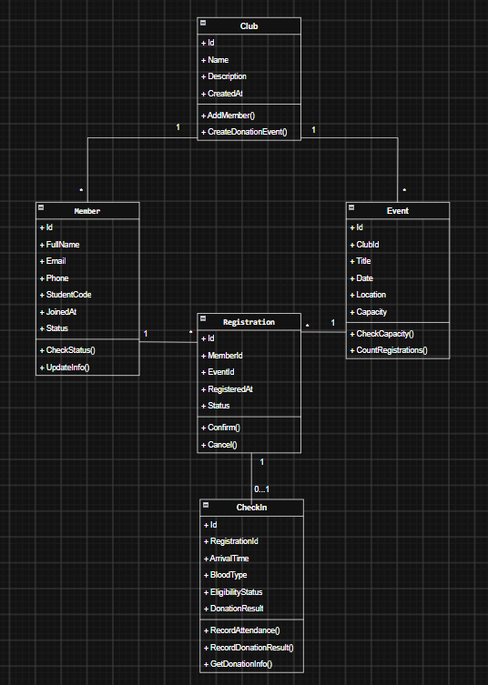

# CÂU LẠC BỘ HIẾN MÁU

## Câu 2. Class Diagram

### Sơ đồ lớp

*Hình 1. Sơ đồ lớp hệ thống Câu lạc bộ hiến máu.*

### Các lớp trong hệ thống

- `Club`: Quản lý câu lạc bộ, thành viên và đợt hiến máu.
- `Member`: Lưu thông tin sinh viên.
- `Event`: Quản lý đợt hiến máu và số lượng đăng ký.
- `Registration`: Quản lý thông tin đăng ký tham gia.
- `CheckIn`: Ghi nhận điểm danh, điều kiện và kết quả hiến máu.
